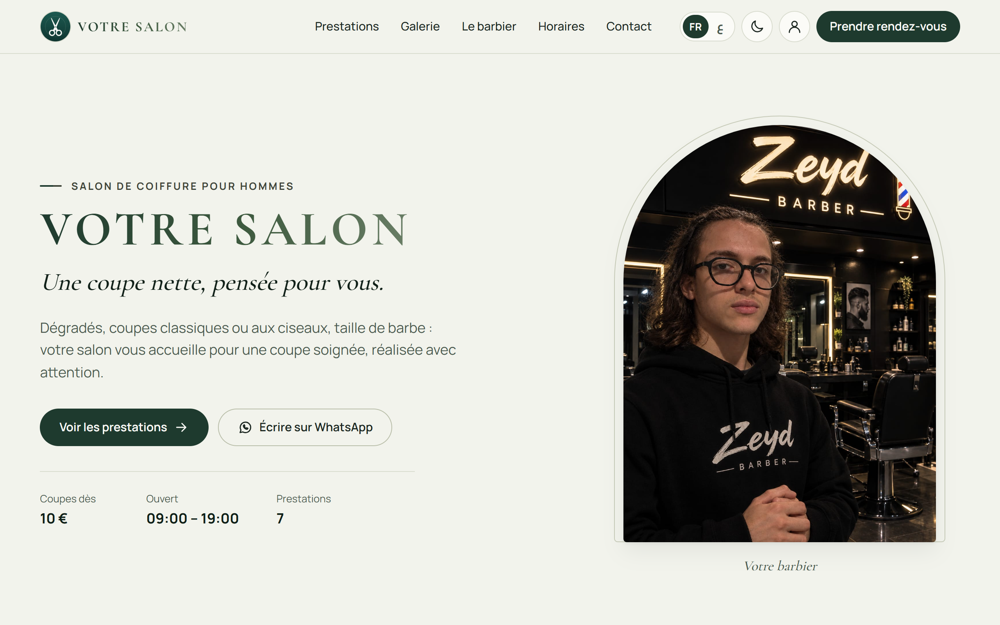
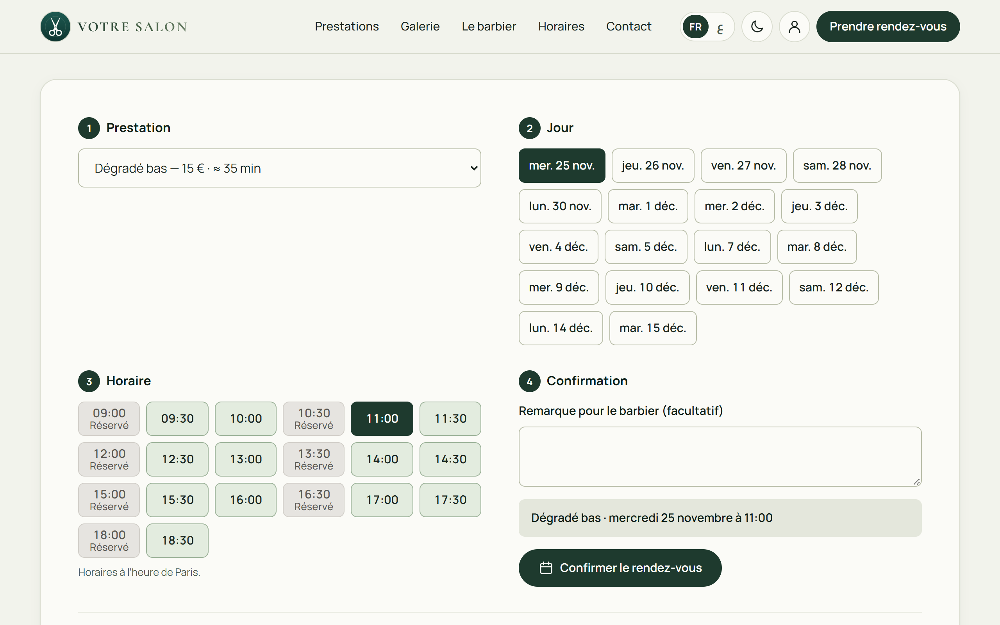
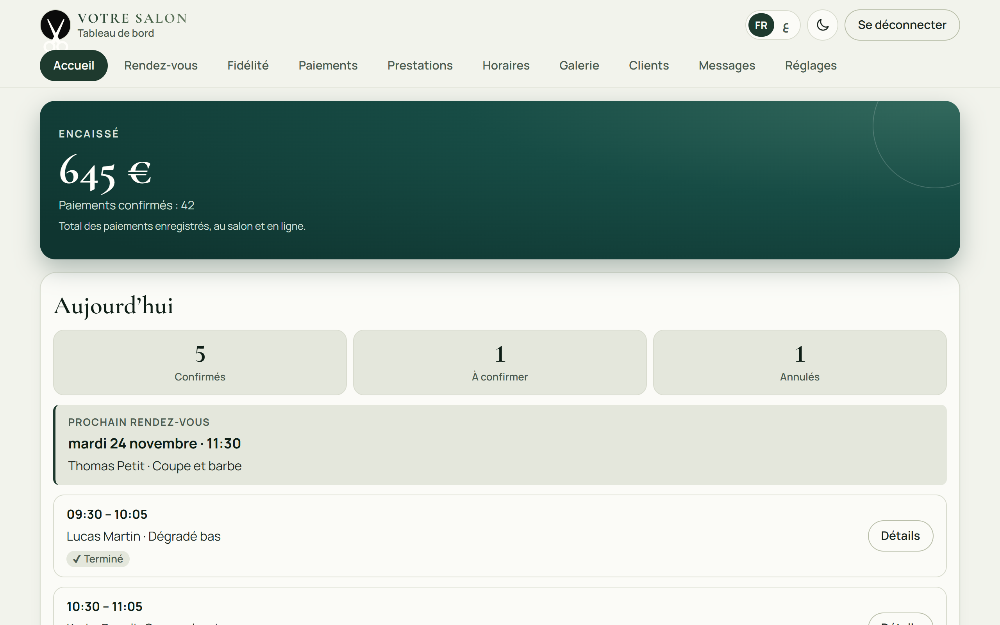
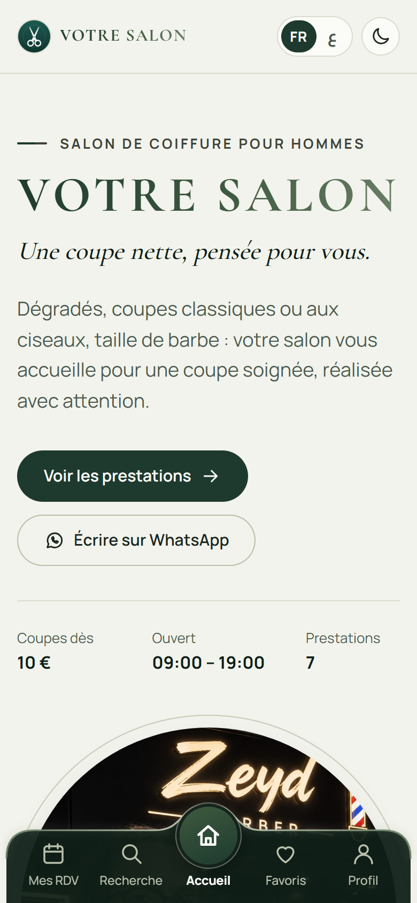
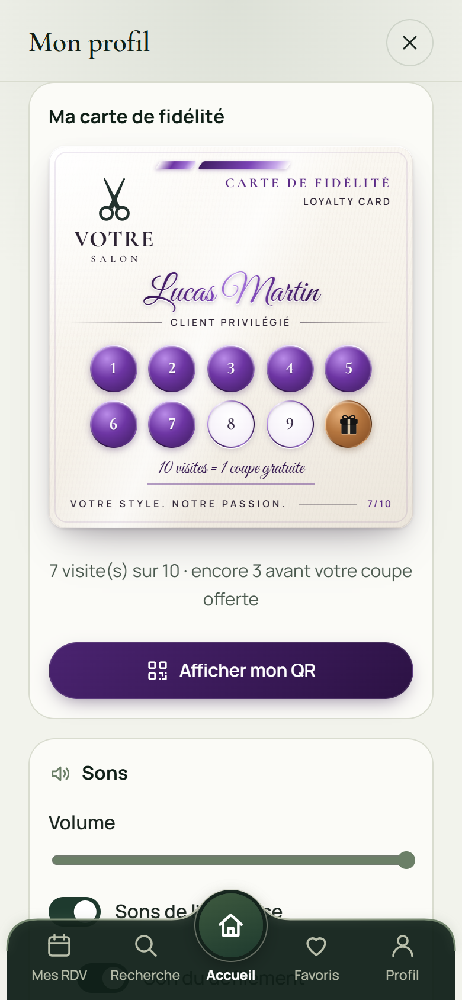
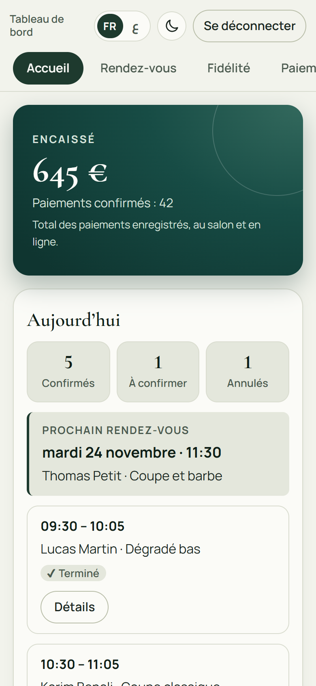

# Site de réservation pour salon de coiffure

Un site pour un salon de coiffure pour hommes : les clients réservent leur créneau en ligne, et le salon gère ses rendez-vous depuis un tableau de bord. Je l'ai conçu pour qu'il puisse être repris par n'importe quel salon : il suffit de changer le nom, le logo et les liens de contact.

Démo en ligne : https://barber-website-aq1.pages.dev (tableau de bord : `/admin`)

## Fonctionnalités

Côté client, on choisit une prestation, un jour et un horaire libre, et le rendez-vous est confirmé tout de suite. Chaque client a un compte (avec confirmation par e-mail) où il retrouve ses rendez-vous, peut les annuler ou les déplacer, écrire au salon et suivre sa carte de fidélité : 10 visites donnent une coupe offerte.

Côté salon, le tableau de bord montre les rendez-vous du jour, les clients, les messages et la fidélité (avec scan du QR code du client). Le salon peut aussi modifier ses prestations, ses prix, ses horaires et ses jours de fermeture.

Le site est disponible en français et en arabe, fonctionne bien sur téléphone et peut s'installer comme une application (PWA).

## Captures d'écran

| Accueil | Réservation |
|---|---|
|  |  |

| Tableau de bord |
|---|
|  |

| Accueil (mobile) | Carte de fidélité | Tableau de bord (mobile) |
|---|---|---|
|  |  |  |

Les noms et rendez-vous visibles sur les captures sont des données de démonstration.

## Technologies

Le site est écrit en HTML, CSS et JavaScript (modules ES), sans framework ni étape de build. Les données et les comptes sont gérés par Supabase (PostgreSQL et Auth), et le site est hébergé sur Cloudflare Pages. J'utilise Biome pour le lint et le formatage, et le test runner de Node avec PGlite pour tester la base de données en local.

## Choix de sécurité

Toutes les tables sont protégées par Row Level Security : un client ne peut lire et modifier que ses propres données, et les droits du salon sont vérifiés dans la base, pas dans le navigateur.

Un nouveau compte est toujours un compte client. Personne ne peut changer son propre rôle ; seul un administrateur peut donner l'accès au tableau de bord.

La double réservation est impossible : une contrainte d'exclusion dans PostgreSQL empêche deux rendez-vous confirmés de se chevaucher, même si deux personnes cliquent au même moment.

Le site ne contient que la clé publique de Supabase. Aucune clé secrète n'est envoyée au navigateur.

## Lancer le projet en local

```bash
npm install
npm test        # tests de la base de données et des règles métier
npm run check   # lint et formatage
```

Ensuite, il suffit de servir le dossier `Zeyd/` avec un serveur statique (par exemple Live Server dans VS Code). Pour utiliser votre propre base, créez un projet Supabase, appliquez les migrations du dossier `supabase/migrations/` et mettez l'URL et la clé publique du projet dans `Zeyd/config.js`. Le détail est dans `docs/SUPABASE_SETUP.md`.

## Organisation du code

```
Zeyd/                 le site et le tableau de bord
supabase/migrations/  schéma, règles RLS et fonctions de la base
tests/                tests automatisés
docs/                 guides d'installation
```
